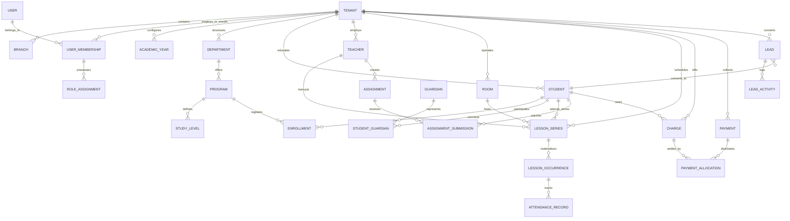

# MusicOS — PostgreSQL & Prisma Database Schema Specification

**Document Version:** 1.0.0  
**Database Engine:** PostgreSQL 17  
**ORM:** Prisma 7 with Prisma Client Extensions  
**Primary Key Standard:** UUIDv7 (Timestamp-ordered 128-bit identifiers)  
**Monetary Standard:** Integer Cents (EUR `cents` bigint/integer)

---

## 1. Entity Relationship Diagram (ERD)

---

## 2. Core Entity Catalog

### 2.1 Platform & Tenancy Domain

#### `tenants`
The top-level boundary for conservatory data isolation.
- `id` (UUIDv7, PK): Unique tenant identifier.
- `name` (TEXT, NOT NULL): Legal name of the conservatory (e.g., "Ωδείο Αρμονία").
- `slug` (TEXT, UNIQUE, NOT NULL): URL-safe identifier for tenant routing.
- `status` (`TenantStatus`, NOT NULL): `TRIAL`, `ACTIVE`, `SUSPENDED`.
- `planId` (UUID, FK `plans.id`): Active SaaS subscription tier.
- `trialEndsAt` (TIMESTAMPTZ): Expiration date of trial access.
- `locale` (TEXT, DEFAULT 'el'): Primary language ('el', 'en').
- `timezone` (TEXT, DEFAULT 'Europe/Athens'): IANA timezone string.
- `currency` (TEXT, DEFAULT 'EUR'): ISO 4217 currency code.
- `createdAt`, `updatedAt`, `deletedAt` (TIMESTAMPTZ).

#### `branches`
Physical campuses or operational branches operated by a tenant.
- `id` (UUIDv7, PK)
- `tenantId` (UUID, FK `tenants.id`, NOT NULL)
- `name` (TEXT, NOT NULL): e.g. "Κεντρικό", "Παράρτημα Βορείων".
- `code` (TEXT): Unique short code within tenant.
- `address`, `city`, `postalCode`, `phone`, `email` (TEXT).
- `isMain` (BOOLEAN, DEFAULT FALSE).
- *Composite Key:* `UNIQUE (tenantId, id)` (enables composite foreign key protection).

---

### 2.2 Identity & Access Management (IAM)

#### `users`
Global identities representing individual humans across the SaaS platform.
- `id` (UUIDv7, PK)
- `email` (TEXT, UNIQUE, NOT NULL): Normalized lowercase email address.
- `passwordHash` (TEXT, NOT NULL): Argon2id cryptographically salted hash.
- `firstName`, `lastName` (TEXT, NOT NULL).
- `phone` (TEXT).
- `isSuperAdmin` (BOOLEAN, DEFAULT FALSE): Platform-wide administrator flag.
- `mfaSecret` (TEXT): Base32 encoded TOTP secret (encrypted).
- `mfaEnabled` (BOOLEAN, DEFAULT FALSE).
- `status` (`UserStatus`, DEFAULT 'ACTIVE').

#### `tenant_memberships`
Links a global user to a specific conservatory tenant with an authoritative operational role.
- `id` (UUIDv7, PK)
- `tenantId` (UUID, FK `tenants.id`, NOT NULL)
- `userId` (UUID, FK `users.id`, NOT NULL)
- `role` (`MembershipRole`, NOT NULL): `DIRECTOR`, `ADMINISTRATOR`, `TEACHER`, `STUDENT`, `GUARDIAN`.
- *Constraint:* `UNIQUE (tenantId, userId)` (one primary role per tenant).

#### `support_access_grants`
Time-limited, read-only administrative authorization records for troubleshooting.
- `id` (UUIDv7, PK)
- `tenantId` (UUID, FK `tenants.id`, NOT NULL)
- `grantedByUserId` (UUID, FK `users.id`, NOT NULL): Platform admin requester.
- `reason` (TEXT, NOT NULL): Detailed justification for access.
- `startsAt` (TIMESTAMPTZ, NOT NULL)
- `expiresAt` (TIMESTAMPTZ, NOT NULL): Maximum 60-minute lifetime.
- `revokedAt` (TIMESTAMPTZ)
- `revokedByUserId` (UUID, FK `users.id`).

---

### 2.3 Academics Domain

#### `academic_years`
Operational annual cycles governing syllabi, registrations, and accounting.
- `id` (UUIDv7, PK)
- `tenantId` (UUID, FK `tenants.id`, NOT NULL)
- `name` (TEXT, NOT NULL): e.g., "2026–2027".
- `startDate`, `endDate` (DATE, NOT NULL).
- `isCurrent` (BOOLEAN, DEFAULT FALSE).
- *Check Constraint:* `endDate > startDate`.

#### `departments` & `programs`
The musical faculties and statutory curricula of the conservatory.
- **`departments`:** e.g. "Κλασικά Όργανα", "Μοντέρνα Μουσική", "Ανώτερα Θεωρητικά".
- **`programs`:** Specific instrument/discipline courses (e.g. "Πιάνο", "Βιολί", "Ακουστική Κιθάρα", "Ειδικό Αρμονίας").
- **`study_levels`:** Official Greek grade classifications (e.g., "Προκαταρκτική", "Κατωτέρα 1ο Έτος", "Ανωτέρα 3ο Έτος").

---

### 2.4 People & Relationships

#### `students`
- `id` (UUIDv7, PK)
- `tenantId` (UUID, FK `tenants.id`, NOT NULL)
- `userId` (UUID, FK `users.id`, UNIQUE, NULLABLE): Linked login identity (optional for minors).
- `studentNumber` (TEXT, NOT NULL): Formal registration index (Αριθμός Μητρώου).
- `firstName`, `lastName` (TEXT, NOT NULL).
- `fatherName` (TEXT): Statutory Greek registration requirement (Πατρώνυμο).
- `birthDate` (DATE).
- `status` (`StudentStatus`, DEFAULT 'ACTIVE').
- `consentMarketing`, `consentMedia` (BOOLEAN, DEFAULT FALSE).
- *Composite Key:* `UNIQUE (tenantId, id)`.

#### `guardians` & `student_guardians`
Models parents and legal guardians of minor students.
- **`guardians`:** Parent contact info, tax ID (ΑΦΜ), and linked user identity.
- **`student_guardians`:** Explicit relationship mapping (`MOTHER`, `FATHER`, `LEGAL_GUARDIAN`) with flags for primary billing contact and legal emergency authorization.

#### `teachers`
- `id` (UUIDv7, PK)
- `tenantId` (UUID, FK `tenants.id`, NOT NULL)
- `userId` (UUID, FK `users.id`, UNIQUE, NOT NULL).
- `specialties` (TEXT[]): List of taught instruments and subjects.
- `bio` (TEXT).
- `hourlyRateCents` (BIGINT): Internal rate tracking.
- *Composite Key:* `UNIQUE (tenantId, id)`.

---

### 2.5 Scheduling & Attendance

#### `rooms`
Teaching studios and concert halls.
- `id` (UUIDv7, PK)
- `tenantId` (UUID, NOT NULL)
- `branchId` (UUID, NOT NULL)
- `name` (TEXT, NOT NULL): e.g., "Αίθουσα 3 - Πιάνο Steinway".
- `capacity` (INTEGER, DEFAULT 1).
- `hasPiano` (BOOLEAN, DEFAULT FALSE).
- *Composite FK:* `FOREIGN KEY (tenantId, branchId) REFERENCES branches(tenantId, id)`.

#### `lesson_series`
The master recurring lesson contract.
- `id` (UUIDv7, PK)
- `tenantId` (UUID, NOT NULL)
- `branchId`, `teacherId`, `programId`, `roomId` (UUID, NOT NULL)
- `studentId` (UUID, NULLABLE): NULL for group classes.
- `dayOfWeek` (INTEGER, 1=Monday to 7=Sunday).
- `startTime` (TIME, NOT NULL): e.g., "16:30".
- `durationMinutes` (INTEGER, NOT NULL): e.g., 45.
- `type` (`LessonType`): `INDIVIDUAL`, `GROUP`, `ENSEMBLE`.
- `status` (`SeriesStatus`, DEFAULT 'ACTIVE').
- *Composite FKs:* Multi-column references to `branches`, `teachers`, `rooms`, and `students` guaranteeing absolute tenant coherence.

#### `lesson_occurrences`
Individual materialized calendar lesson events.
- `id` (UUIDv7, PK)
- `tenantId` (UUID, NOT NULL)
- `seriesId` (UUID, FK `lesson_series.id`, NOT NULL)
- `date` (DATE, NOT NULL).
- `startsAt`, `endsAt` (TIMESTAMPTZ, NOT NULL).
- `status` (`LessonStatus`, DEFAULT 'SCHEDULED'): `SCHEDULED`, `COMPLETED`, `CANCELLED`, `RESCHEDULED`.
- `cancellationReason` (TEXT).
- `makeupEligible` (BOOLEAN, DEFAULT FALSE).
- *Check Constraint:* `endsAt > startsAt`.

#### `attendance_records`
- `id` (UUIDv7, PK)
- `tenantId` (UUID, NOT NULL)
- `lessonId` (UUID, FK `lesson_occurrences.id`, NOT NULL)
- `studentId` (UUID, FK `students.id`, NOT NULL)
- `status` (`AttendanceStatus`, NOT NULL): `PRESENT`, `ABSENT`, `LATE`, `EXCUSED`.
- `latenessMinutes` (INTEGER, DEFAULT 0).
- `notes` (TEXT).
- *Constraint:* `UNIQUE (lessonId, studentId)`.

---

### 2.6 Financial Engine

#### `charges`
Debits posted to a student's institutional ledger.
- `id` (UUIDv7, PK)
- `tenantId` (UUID, NOT NULL)
- `studentId` (UUID, NOT NULL)
- `amountCents` (BIGINT, NOT NULL): Total charge amount.
- `paidAmountCents` (BIGINT, DEFAULT 0, NOT NULL): Allocated paid amount.
- `dueDate` (DATE, NOT NULL).
- `title` (TEXT, NOT NULL): e.g. "Δίδακτρα Νοεμβρίου 2026".
- `status` (`ChargeStatus`, DEFAULT 'PENDING'): `PENDING`, `PARTIAL`, `PAID`, `OVERDUE`, `CANCELLED`.
- *Check Constraint:* `amountCents > 0`, `paidAmountCents >= 0`, `paidAmountCents <= amountCents`.

#### `payments`
Credits recorded against tuition accounts.
- `id` (UUIDv7, PK)
- `tenantId` (UUID, NOT NULL)
- `studentId` (UUID, NOT NULL)
- `amountCents` (BIGINT, NOT NULL): Total received payment.
- `method` (`PaymentMethod`, NOT NULL): `CASH`, `CARD`, `BANK_TRANSFER`, `OTHER`.
- `receiptNumber` (TEXT, NOT NULL): Unique tenant-scoped sequential receipt number.
- `recordedById` (UUID, FK `users.id`, NOT NULL).
- `voidedAt` (TIMESTAMPTZ): Soft-void timestamp for audit consistency.
- `voidReason` (TEXT).

#### `payment_allocations`
Immutable junction linking payments to specific charges.
- `id` (UUIDv7, PK)
- `tenantId` (UUID, NOT NULL)
- `paymentId` (UUID, FK `payments.id`, NOT NULL)
- `chargeId` (UUID, FK `charges.id`, NOT NULL)
- `amountCents` (BIGINT, NOT NULL).
- *Check Constraint:* `amountCents > 0`.

---

### 2.7 Admissions CRM Domain

#### `leads`
Prospective student inquiries and recruitment pipeline.
- `id` (UUIDv7, PK)
- `tenantId` (UUID, NOT NULL)
- `branchId` (UUID, NOT NULL)
- `studentFirstName`, `studentLastName` (TEXT, NOT NULL)
- `contactName`, `contactEmail`, `contactPhone` (TEXT)
- `source` (`LeadSource`, DEFAULT 'WEB_FORM'): `WEB_FORM`, `PHONE`, `WALK_IN`, `REFERRAL`, `CAMPAIGN`, `SOCIAL`, `OTHER`.
- `stage` (`LeadStage`, DEFAULT 'NEW'): `NEW`, `CONTACTED`, `TRIAL_BOOKED`, `TRIAL_COMPLETED`, `OFFER_SENT`, `ENROLLED`, `LOST`.
- `programId` (UUID, FK `programs.id`).
- `assignedToId` (UUID, FK `users.id`).
- `convertedStudentId` (UUID, FK `students.id`).
- `convertedAt` (TIMESTAMPTZ).
- `deletedAt` (TIMESTAMPTZ).

#### `lead_activities`
Audited interactions, calls, and stage movements.
- `id` (UUIDv7, PK)
- `tenantId` (UUID, NOT NULL)
- `leadId` (UUID, FK `leads.id`, NOT NULL)
- `actorId` (UUID, FK `users.id`).
- `type` (`LeadActivityType`, NOT NULL): `NOTE`, `CALL`, `EMAIL`, `MEETING`, `STAGE_CHANGE`, `TRIAL_SCHEDULED`, `FOLLOW_UP`, `CONVERSION`.
- `fromStage`, `toStage` (`LeadStage`).
- `body` (TEXT).
- `createdAt` (TIMESTAMPTZ, DEFAULT NOW()).

---

## 3. Database Integrity & Performance Patterns

1. **UUIDv7 Implementation:** Native timestamp prefixing eliminates B-tree index churn common in random UUIDv4.
2. **Deterministic Composite Foreign Keys:** Prevents cross-tenant corruption by binding foreign keys to `(tenantId, id)`.
3. **Database Check Constraints:** Enforces invariants directly inside the database engine (`endsAt > startsAt`, `amountCents > 0`).
4. **Soft-Delete Filtering:** Standard `deletedAt IS NULL` indexing on frequently queried tables (`students`, `teachers`, `lesson_series`, `leads`).
5. **Integer Currency Handling:** Explicit BIGINT `cents` fields with zero floating-point representation.
