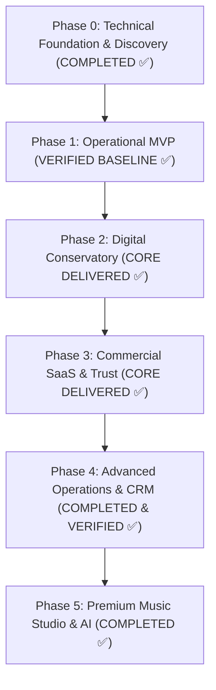

# MusicOS — Strategic Product & Development Roadmap

**Document Version:** 1.0.0  
**Current State:** Phase 0, Phase 1, Phase 2, Phase 3, Phase 4, Phase 5 Completed & Verified ✅  
**Delivery Model:** Progressive, evidence-driven, releasable vertical slices backed by PostgreSQL, NestJS, and Angular.

---

## 1. Roadmap Overview & Implementation Phases

---

## 2. Phase-by-Phase Execution Backlog

### Phase 0 — Discovery & Technical Foundation (Status: COMPLETE ✅)
- [x] Monorepo workspace initialization (`apps/api`, `apps/web`, `e2e`).
- [x] Comprehensive domain analysis for Greek and EU conservatories.
- [x] Roles & Permissions Matrix definition (6 distinct user experiences).
- [x] Normalized PostgreSQL 17 relational schema with UUIDv7 identifiers.
- [x] Architecture Decision Records (ADRs) recorded in `DECISIONS.md`.
- [x] Comprehensive technical specifications suite (PRD, DB Schema, API Specs, Security).
- [x] Continuous Integration quality gates (oxlint, TypeScript compilation, Vitest, Playwright).
- [x] Foundational design system specifications and reusable component tokens.

---

### Phase 1 — Operational MVP (Status: COMPLETE & VERIFIED ✅)
*Milestone: A fully functional Greek music conservatory management platform capable of running everyday operations.*
- [x] Multi-tenant data isolation with cryptographically verified tenant tokens.
- [x] Secure authentication with Argon2id hashing, rotating refresh cookies, and session revocation.
- [x] Multi-tenant membership selector for users associated with multiple conservatories.
- [x] Director and Secretariat administrative dashboards with live operational KPIs.
- [x] Student registry with guardian linkages and Greek statutory fields (Πατρώνυμο, ΑΜ).
- [x] Faculty teacher registry with specialty tracking and studio assignments.
- [x] Academics catalog: Departments, study levels, academic years, and curriculum programs.
- [x] Studio room registry with instrument tracking (pianos, equipment).
- [x] Master recurring weekly lesson scheduling engine with real-time collision detection.
- [x] Attendance register with Present, Absent, Late, Excused statuses and bulk actions.
- [x] Integer-cent financial tuition ledger: Charges, payments, oldest-first allocation, receipt PDFs.
- [x] In-app notification inbox with email outbox worker.

---

### Phase 2 — Digital Conservatory (Status: PARTIALLY DELIVERED 🟡)
*Milestone: Deep educational collaboration between students, teachers, and guardians.*
- [x] **Student & Guardian Portal:** Multi-child selection, lesson schedules, attendance logs, and financial ledgers.
- [x] **Study Assignments & Submissions:** Teacher assignment creation, student recording uploads, review workspace, and qualitative grading (Delivered 2026-10-25).
- [x] **Examination Governance:** Exam periods, candidate registration, committee scoring, promotion workflows, and draft minutes generation.
- [x] **Digital Document Engine:** Protocol numbering (Αριθμός Πρωτοκόλλου), draft/issued lifecycle, vector PDF rendering with watermarks.
- [x] **Foundational Practice Tools:** In-browser precision metronome, chromatic tuner, and offline score reading.
- [ ] *Next in Phase 2:* Online lesson link integration, comprehensive quizzes, and automated exam candidacy checks.

---

### Phase 3 — Commercial SaaS & Platform Trust (Status: PARTIALLY DELIVERED 🟡)
*Milestone: Self-sustaining multi-tenant platform infrastructure for commercial launch.*
- [x] **Super Admin Platform Console:** Tenant provisioning, trial management, plan limits, and global metrics.
- [x] **Support Access Grant Model:** Time-limited, audited, read-only administrative access (No silent impersonation).
- [x] **Database Hardening:** Composite foreign keys enforcing cross-tenant referential coherence; database-level check constraints.
- [x] **Soft-Delete & Trash Recovery:** Full lifecycle recovery across students, lesson series, and announcements.
- [ ] *Next in Phase 3:* Automated SaaS subscription billing invoices and payment collection webhooks.
- [ ] *Next in Phase 3:* Tenant storage quota enforcement and automated usage metering.

---

### Phase 4 — Advanced Operations & CRM (Status: COMPLETE & VERIFIED ✅)
*Milestone: High-velocity student acquisition and comprehensive institutional logistics.*
- [x] **Admissions CRM Engine (Slice 5):**
  - Database schema deployed (`leads`, `lead_activities`, `LeadStage`).
  - Backend API: Lead ingestion, activity logging, stage transitions, and transactional enrollment conversion under seat limits.
  - Frontend Workspace: Interactive 7-stage visual Kanban pipeline, lead drawer, and follow-up reminders.
- [x] **Smart Scheduling & Greek Holiday Suppression:**
  - Astronomical Meeus Julian Orthodox Easter algorithm with movable feasts (Kathara Deftera, Megali Paraskevi, Easter Monday, Agiou Pnevmatos) and fixed Greek holidays.
  - Automated collision suppression and calendar seeding (`POST /api/scheduling/calendar/seed-greek`).
- [x] **Concert & Event Management:**
  - Recital planning, performer registration, Part 1/Part 2 stage running order builder, QR ticket admission check-in, and structured digital concert program generator.
- [x] **Instrument Inventory & Lending:**
  - Musical asset tracking, serial numbers, student lending checkout/return workflows with deposit reconciliation, and European/Greek classical standard 442 Hz piano tuning alert engine.
- [x] **Music Learning Practice Studio:**
  - Web Audio API interactive musical interval ear trainer (m2 to P8) with ascending/descending/harmonic synthesis modes.

---

### Phase 5 — Premium Music Education & AI (Status: COMPLETED ✅)
*Milestone: Cutting-edge pedagogical technology and intelligent automation.*
- [x] **Advanced Music Learning Studio:** Ear training (intervals, chords), rhythm dictation, A/B looping, and MusicXML viewer.
- [x] **Practice Engagement Analytics:** Detailed practice session duration and consistency tracking.
- [x] **Intelligent Automation (Human-in-the-Loop):**
  - AI-assisted daily administrative digests.
  - Pedagogical exercise recommendations reviewed by teachers.
  - Automated scheduling conflict explanations.
- [x] **External Integrations:** Certified Greek e-invoicing (AADE / myDATA) adapter and electronic signature provider integrations.

---

## 3. Dependency Graph & Release Criteria

| Target Vertical Slice | Dependencies | Verification Criteria |
|---|---|---|
| **Phase 0 Documentation** | Repository Analysis | 12 complete architectural specifications passing peer review |
| **Foundation Hardening** | Phase 1 Baseline | 100% passing e2e tests with zero unscoped database queries |
| **Admissions CRM** | DB Migration `20261025140000` | Full lead-to-enrolled conversion creating verified Student & Guardian |
| **Advanced Scheduling** | Academics & Rooms | Automatic suppression of lessons falling on Greek national holidays |
| **Events & Inventory** | People & Rooms | Recital running order with room booking and instrument assignment |
| **Commercial Billing** | Platform Module | Subscription invoices generated on schedule with webhook idempotency |
