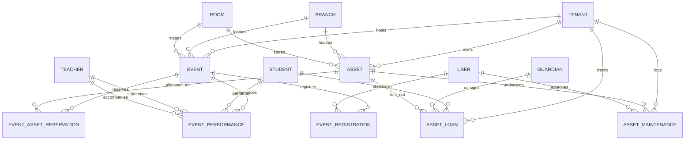

# MusicOS — Engineering Blueprint: Concert, Exam Events & Musical Asset Inventory

**Document Version:** 1.0.0  
**PRD Reference:** Section 3.5 (Concert, Exam Event & Inventory Management — 20 Capabilities)  
**System Architecture:** Angular 22 Zoneless Signals, NestJS 12 (ESM Native), PostgreSQL 17, Prisma 7  
**Security & Multi-Tenancy:** Composite Foreign Keys, UUIDv7 Identifiers, Probe-Resistant 404s, EUR Integer Cents  
**Date:** October 2026  

---

## 1. Executive Summary & Domain Architecture

The **Concert, Exam Events & Musical Asset Inventory** module delivers institutional-grade logistics, academic showcase governance, and physical instrument lifecycle management for music conservatories (*Ωδεία*). In a conservatory ecosystem, performances and exams are not mere calendar entries—they are rigorous pedagogical milestones governed by statutory guidelines, stage protocol, acoustic requirements, and inventory dependencies.

### 1.1 Complete PRD Section 3.5 Capability Coverage

| # | Capability | Blueprint Section & Architecture Component |
|---|---|---|
| 1 | **Concert & Event Planner** | `Event` model, event lifecycle FSM (`DRAFT` → `SCHEDULED` → `COMPLETED`), branch/room scheduling |
| 2 | **Institutional Concert Calendar** | Public/internal calendar feeds, multi-branch aggregation, `/api/events/calendar` |
| 3 | **Performer Registration Workflow** | `EventPerformance` candidate submission, teacher approvals, soloist & ensemble registrations |
| 4 | **Repertoire Timing & Submission** | Strict minute/second timings, movement definitions, composer & opus metadata |
| 5 | **Stage Running Order Builder** | Interactive drag-and-drop reordering, Part 1/Part 2 split, intermission management, conflict guards |
| 6 | **Auditorium & Stage Allocation** | Multi-room event reservation (Main Stage, Backstage Warmup Rooms, Green Room) |
| 7 | **Audience Capacity Enforcement** | Hard fire-code seating limits, ticket quota tracking, waitlisting |
| 8 | **Digital Concert Programs** | Responsive mobile programs (`/public/events/:slug/program`), high-resolution print PDF engine |
| 9 | **Event Invitation & RSVP Tracking** | VIP reservations, seat assignments, digital invitation delivery |
| 10 | **QR Code Attendance Check-In** | High-speed mobile camera scanner, HMAC-signed ticket tokens, offline-sync check-in |
| 11 | **Examination Session Scheduling** | Grouping candidates into morning/afternoon jury blocks, timetable balancing |
| 12 | **Committee Logistics** | Examiner desk assignments, protocol sheets, hospitality & acoustic stage setup |
| 13 | **Acoustic Equipment Reservations** | `EventAssetReservation` linking microphones, amplifiers, music stands to events |
| 14 | **Instrument Asset Inventory** | Comprehensive registry for Pianos, Strings, Woodwinds, Brass, Percussion, AV Gear |
| 15 | **Serial Number & Asset Tagging** | Barcode/RFID asset tags (`ARM-PNO-001`), manufacturer serial numbers |
| 16 | **Instrument Lending System** | Custody checkout to students, guardian co-signatures, loan contracts, deposit tracking |
| 17 | **Lending Return Inspection** | Check-in condition grading, wear-and-tear assessment, missing accessory tracking |
| 18 | **Maintenance & Tuning Logs** | Complete service logbook, pitch measurements ($442\text{ Hz}$ vs $440\text{ Hz}$), luthier repairs |
| 19 | **Scheduled Maintenance Alerts** | Proactive engine tracking tuning intervals, humidity shifts, pre-exam tuning deadlines |
| 20 | **Asset Availability Tracking** | Real-time state machine: `AVAILABLE`, `IN_USE_STUDIO`, `ON_LOAN`, `RESERVED_EVENT`, `IN_MAINTENANCE` |

### 1.2 Greek Conservatory Domain Modeling

1. **Academic Showcase Milestones:**
   - **Χριστουγεννιάτικες Συναυλίες (Christmas Concerts):** Multi-ensemble showcases featuring junior choirs, guitar orchestras, and student chamber groups.
   - **Εαρινές & Θερινές Συναυλίες (Spring/Summer Recitals):** Formal solo and department showcases determining promotion readiness.
   - **Διπλωματικές Συναυλίες (Graduation Diploma Recitals):** Statutory public recitals before a state-appointed committee for students completing their *Πτυχίο* or *Δίπλωμα*.
   - **Σεμινάρια / Masterclasses:** Guest artist masterclasses requiring room booking, active performer slots, and auditor passes.
   - **Προκριματικές Ακροάσεις (Pre-Exam Mock Auditions):** Internal benchmark performances prior to formal jury exams.
2. **Statutory Document & Protocol Numbering (Αριθμός Πρωτοκόλλου):**
   - Formal loan contracts for conservatory instruments and official recital diplomas must link to atomic sequence counters (`NumberSequence`).
3. **Concert Pitch Standard:**
   - European and Greek classical conservatory performance standard is calibrated to **$442\text{ Hz}$** (unlike standard commercial $440\text{ Hz}$). The asset engine explicitly records measured pre-service and post-service pitch frequencies.
4. **GDPR & Protection of Minors:**
   - Minor student performers are linked through their guardian records. Media publishing waivers (`consentMedia`) are validated in real time before generating public printed or web concert programs.

---

## 2. Relational Database Architecture & Prisma 7 Models

### 2.1 Entity Relationship Diagram (ERD)



---

### 2.2 Prisma 7 Schema Specifications

```prisma
// ─────────────────────────────────────────────────────────────────────────────
// Enums for Concerts, Exam Events & Asset Inventory
// ─────────────────────────────────────────────────────────────────────────────

enum EventType {
  CONCERT
  RECITAL
  MASTERCLASS
  AUDITION
  EXAM_SESSION
  WORKSHOP
  COMPETITION
}

enum EventStatus {
  DRAFT
  SCHEDULED
  REGISTRATION_OPEN
  REGISTRATION_CLOSED
  IN_PROGRESS
  COMPLETED
  CANCELLED
}

enum PerformanceStatus {
  PROPOSED
  CONFIRMED
  STANDBY
  PERFORMED
  WITHDRAWN
}

enum RegistrationStatus {
  REGISTERED
  WAITLISTED
  CHECKED_IN
  CANCELLED
  NO_SHOW
}

enum RsvpStatus {
  ATTENDING
  DECLINED
  TENTATIVE
}

enum AssetCategory {
  GRAND_PIANO
  UPRIGHT_PIANO
  DIGITAL_PIANO
  STRING_INSTRUMENT
  WOODWIND
  BRASS
  PERCUSSION
  PLUCKED_STRING
  AUDIO_EQUIPMENT
  STAGE_ACCESSORY
}

enum AssetCondition {
  PRISTINE
  EXCELLENT
  GOOD
  FAIR
  POOR
  NEEDS_REPAIR
  UNUSABLE
}

enum AssetStatus {
  AVAILABLE
  IN_USE_STUDIO
  ON_LOAN
  RESERVED_EVENT
  IN_MAINTENANCE
  DECOMMISSIONED
  LOST
}

enum LoanStatus {
  DRAFT
  ACTIVE
  RETURN_OVERDUE
  RETURNED
  DAMAGED_RETURN
  LOST
}

enum MaintenanceType {
  PIANO_TUNING
  VOICING_REGULATION
  RESTRINGING
  LUTHIER_REPAIR
  PAD_REPLACEMENT
  CLEANING_OVERHAUL
  ELECTRICAL_SAFETY
  ROUTINE_INSPECTION
}

enum MaintenanceStatus {
  SCHEDULED
  IN_PROGRESS
  COMPLETED
  CANCELLED
}

// ─────────────────────────────────────────────────────────────────────────────
// Event Entities
// ─────────────────────────────────────────────────────────────────────────────

model Event {
  id                         String       @id @default(uuid(7)) @db.Uuid
  tenantId                   String       @db.Uuid
  branchId                   String       @db.Uuid
  roomId                     String?      @db.Uuid
  academicYearId             String?      @db.Uuid
  title                      String
  slug                       String
  eventType                  EventType    @default(CONCERT)
  status                     EventStatus   @default(DRAFT)
  description                String?      @db.Text
  startsAt                   DateTime     @db.Timestamptz(3)
  endsAt                     DateTime     @db.Timestamptz(3)
  doorsOpenAt                DateTime?    @db.Timestamptz(3)
  maxCapacity                Int          @default(100)
  isPublic                   Boolean      @default(true)
  requiresRegistration       Boolean      @default(true)
  ticketPriceCents           Int          @default(0)
  programNotes               String?      @db.Text
  intermissionDurationMinutes Int         @default(15)
  coverImageFileId           String?      @db.Uuid
  protocolNumber             String?
  createdById                String?      @db.Uuid
  deletedAt                  DateTime?    @db.Timestamptz(3)
  deletedById                String?      @db.Uuid
  createdAt                  DateTime     @default(now()) @db.Timestamptz(3)
  updatedAt                  DateTime     @updatedAt @db.Timestamptz(3)

  // Relations
  tenant         Tenant                  @relation(fields: [tenantId], references: [id], onDelete: Cascade)
  branch         Branch                  @relation(fields: [tenantId, branchId], references: [tenantId, id], onDelete: NoAction, onUpdate: NoAction)
  room           Room?                   @relation(fields: [tenantId, roomId], references: [tenantId, id], onDelete: NoAction, onUpdate: NoAction)
  academicYear   AcademicYear?           @relation(fields: [tenantId, academicYearId], references: [tenantId, id], onDelete: SetNull)
  createdBy      User?                   @relation("EventCreatedBy", fields: [createdById], references: [id], onDelete: SetNull)
  performances   EventPerformance[]
  registrations  EventRegistration[]
  reservations   EventAssetReservation[]

  @@unique([tenantId, slug])
  @@unique([tenantId, id])
  @@index([tenantId, startsAt])
  @@index([tenantId, branchId, status])
  @@index([tenantId, eventType])
  @@map("events")
}

model EventPerformance {
  id                     String            @id @default(uuid(7)) @db.Uuid
  tenantId               String            @db.Uuid
  eventId                String            @db.Uuid
  orderIndex             Int
  part                   Int               @default(1)
  studentId              String?           @db.Uuid
  teacherId              String?           @db.Uuid
  accompanistTeacherId   String?           @db.Uuid
  performerDisplayName   String
  pieceTitle             String
  composer               String
  movement               String?
  durationSeconds        Int
  actualDurationSeconds  Int?
  stageNotes             String?           @db.Text
  status                 PerformanceStatus @default(PROPOSED)
  isEnsemble             Boolean           @default(false)
  ensembleName           String?
  additionalPerformerIds String[]          @default([])
  stagePosition          String?
  createdById            String?           @db.Uuid
  deletedAt              DateTime?         @db.Timestamptz(3)
  createdAt              DateTime          @default(now()) @db.Timestamptz(3)
  updatedAt              DateTime          @updatedAt @db.Timestamptz(3)

  // Relations
  tenant             Tenant   @relation(fields: [tenantId], references: [id], onDelete: Cascade)
  event              Event    @relation(fields: [tenantId, eventId], references: [tenantId, id], onDelete: Cascade)
  student            Student? @relation(fields: [tenantId, studentId], references: [tenantId, id], onDelete: SetNull)
  teacher            Teacher? @relation("PerformanceTeacher", fields: [tenantId, teacherId], references: [tenantId, id], onDelete: SetNull)
  accompanistTeacher Teacher? @relation("PerformanceAccompanist", fields: [tenantId, accompanistTeacherId], references: [tenantId, id], onDelete: SetNull)
  createdBy          User?    @relation("PerformanceCreatedBy", fields: [createdById], references: [id], onDelete: SetNull)

  @@unique([tenantId, id])
  @@unique([eventId, part, orderIndex])
  @@index([tenantId, eventId])
  @@index([tenantId, studentId])
  @@index([tenantId, teacherId])
  @@map("event_performances")
}

model EventRegistration {
  id             String             @id @default(uuid(7)) @db.Uuid
  tenantId       String             @db.Uuid
  eventId        String             @db.Uuid
  studentId      String?            @db.Uuid
  attendeeName   String
  attendeeEmail  String
  attendeePhone  String?
  ticketCode     String
  seatNumber     String?
  isVip          Boolean            @default(false)
  ticketCount    Int                @default(1)
  rsvpStatus     RsvpStatus         @default(ATTENDING)
  status         RegistrationStatus @default(REGISTERED)
  checkedInAt    DateTime?          @db.Timestamptz(3)
  checkedInById  String?            @db.Uuid
  checkInNotes   String?
  createdById    String?            @db.Uuid
  createdAt      DateTime           @default(now()) @db.Timestamptz(3)
  updatedAt      DateTime           @updatedAt @db.Timestamptz(3)

  // Relations
  tenant      Tenant   @relation(fields: [tenantId], references: [id], onDelete: Cascade)
  event       Event    @relation(fields: [tenantId, eventId], references: [tenantId, id], onDelete: Cascade)
  student     Student? @relation(fields: [tenantId, studentId], references: [tenantId, id], onDelete: SetNull)
  checkedInBy User?    @relation("RegistrationCheckedInBy", fields: [checkedInById], references: [id], onDelete: SetNull)
  createdBy   User?    @relation("RegistrationCreatedBy", fields: [createdById], references: [id], onDelete: SetNull)

  @@unique([tenantId, id])
  @@unique([tenantId, ticketCode])
  @@index([tenantId, eventId, status])
  @@index([tenantId, attendeeEmail])
  @@index([tenantId, checkedInAt])
  @@map("event_registrations")
}

// ─────────────────────────────────────────────────────────────────────────────
// Musical Asset & Inventory Entities
// ─────────────────────────────────────────────────────────────────────────────

model Asset {
  id                    String         @id @default(uuid(7)) @db.Uuid
  tenantId              String         @db.Uuid
  branchId              String         @db.Uuid
  studioRoomId          String?        @db.Uuid
  assetTag              String
  category              AssetCategory
  manufacturer          String
  model                 String
  serialNumber          String?
  manufactureYear       Int?
  condition             AssetCondition @default(GOOD)
  status                AssetStatus    @default(AVAILABLE)
  purchaseDate          DateTime?      @db.Date
  purchaseCostCents     Int?
  replacementValueCents Int?
  insurancePolicyNo     String?
  isLoanable            Boolean        @default(false)
  maxLoanDays           Int            @default(30)
  requiresTuning        Boolean        @default(false)
  lastTunedAt           DateTime?      @db.Timestamptz(3)
  nextTuningDueAt       DateTime?      @db.Timestamptz(3)
  tuningIntervalDays    Int?           @default(90)
  pitchStandardHz       Int            @default(442)
  notes                 String?        @db.Text
  photoFileId           String?        @db.Uuid
  createdById           String?        @db.Uuid
  deletedAt             DateTime?      @db.Timestamptz(3)
  deletedById           String?        @db.Uuid
  createdAt             DateTime       @default(now()) @db.Timestamptz(3)
  updatedAt             DateTime       @updatedAt @db.Timestamptz(3)

  // Relations
  tenant       Tenant                  @relation(fields: [tenantId], references: [id], onDelete: Cascade)
  branch       Branch                  @relation(fields: [tenantId, branchId], references: [tenantId, id], onDelete: NoAction, onUpdate: NoAction)
  studioRoom   Room?                   @relation(fields: [tenantId, studioRoomId], references: [tenantId, id], onDelete: NoAction, onUpdate: NoAction)
  createdBy    User?                   @relation("AssetCreatedBy", fields: [createdById], references: [id], onDelete: SetNull)
  loans        AssetLoan[]
  maintenance  AssetMaintenance[]
  reservations EventAssetReservation[]

  @@unique([tenantId, id])
  @@unique([tenantId, assetTag])
  @@index([tenantId, branchId, status])
  @@index([tenantId, category, condition])
  @@index([tenantId, nextTuningDueAt])
  @@map("assets")
}

model AssetLoan {
  id                  String         @id @default(uuid(7)) @db.Uuid
  tenantId            String         @db.Uuid
  assetId             String         @db.Uuid
  studentId           String         @db.Uuid
  guardianId          String?        @db.Uuid
  loanDate            DateTime       @db.Date
  expectedReturnDate  DateTime       @db.Date
  returnedAt          DateTime?      @db.Timestamptz(3)
  loanFeeCents        Int            @default(0)
  depositCents        Int            @default(0)
  depositReturned     Boolean        @default(false)
  agreementSigned     Boolean        @default(false)
  agreementSignedAt   DateTime?      @db.Timestamptz(3)
  agreementFileId     String?        @db.Uuid
  protocolNumber      String?
  checkoutCondition   AssetCondition @default(GOOD)
  checkoutAccessories String[]       @default([])
  checkoutNotes       String?        @db.Text
  returnCondition     AssetCondition?
  returnAccessories   String[]       @default([])
  returnNotes         String?        @db.Text
  damageFeeCents      Int            @default(0)
  status              LoanStatus     @default(ACTIVE)
  inspectedById       String?        @db.Uuid
  createdById         String?        @db.Uuid
  createdAt           DateTime       @default(now()) @db.Timestamptz(3)
  updatedAt           DateTime       @updatedAt @db.Timestamptz(3)

  // Relations
  tenant      Tenant    @relation(fields: [tenantId], references: [id], onDelete: Cascade)
  asset       Asset     @relation(fields: [tenantId, assetId], references: [tenantId, id], onDelete: NoAction, onUpdate: NoAction)
  student     Student   @relation(fields: [tenantId, studentId], references: [tenantId, id], onDelete: Cascade)
  guardian    Guardian? @relation(fields: [guardianId], references: [id], onDelete: SetNull)
  inspectedBy User?     @relation("LoanInspectedBy", fields: [inspectedById], references: [id], onDelete: SetNull)
  createdBy   User?     @relation("LoanCreatedBy", fields: [createdById], references: [id], onDelete: SetNull)

  @@unique([tenantId, id])
  @@index([tenantId, assetId])
  @@index([tenantId, studentId])
  @@index([tenantId, status, expectedReturnDate])
  @@map("asset_loans")
}

model AssetMaintenance {
  id                 String            @id @default(uuid(7)) @db.Uuid
  tenantId           String            @db.Uuid
  assetId            String            @db.Uuid
  maintenanceType    MaintenanceType
  technicianName     String
  technicianCompany  String?
  technicianPhone    String?
  technicianEmail    String?
  costCents          Int               @default(0)
  serviceDate        DateTime          @db.Date
  nextServiceDue     DateTime?         @db.Date
  pitchMeasuredHz    Decimal?          @db.Decimal(5, 1)
  pitchLeftHz        Decimal?          @db.Decimal(5, 1)
  humidityPercentage Int?
  temperatureCelsius Decimal?          @db.Decimal(4, 1)
  workPerformed      String            @db.Text
  partsReplaced      String?           @db.Text
  notes              String?           @db.Text
  invoiceNumber      String?
  invoiceFileId      String?           @db.Uuid
  status             MaintenanceStatus @default(COMPLETED)
  approvedById       String?           @db.Uuid
  createdById        String?           @db.Uuid
  createdAt          DateTime          @default(now()) @db.Timestamptz(3)
  updatedAt          DateTime          @updatedAt @db.Timestamptz(3)

  // Relations
  tenant     Tenant @relation(fields: [tenantId], references: [id], onDelete: Cascade)
  asset      Asset  @relation(fields: [tenantId, assetId], references: [tenantId, id], onDelete: Cascade)
  approvedBy User?  @relation("MaintenanceApprovedBy", fields: [approvedById], references: [id], onDelete: SetNull)
  createdBy  User?  @relation("MaintenanceCreatedBy", fields: [createdById], references: [id], onDelete: SetNull)

  @@unique([tenantId, id])
  @@index([tenantId, assetId])
  @@index([tenantId, serviceDate])
  @@index([tenantId, nextServiceDue])
  @@map("asset_maintenance")
}

model EventAssetReservation {
  id                 String    @id @default(uuid(7)) @db.Uuid
  tenantId           String    @db.Uuid
  eventId            String    @db.Uuid
  assetId            String    @db.Uuid
  purpose            String?
  reservedFrom       DateTime  @db.Timestamptz(3)
  reservedUntil      DateTime  @db.Timestamptz(3)
  isReturnedToStudio Boolean   @default(false)
  createdById        String?   @db.Uuid
  createdAt          DateTime  @default(now()) @db.Timestamptz(3)
  updatedAt          DateTime  @updatedAt @db.Timestamptz(3)

  // Relations
  tenant    Tenant @relation(fields: [tenantId], references: [id], onDelete: Cascade)
  event     Event  @relation(fields: [tenantId, eventId], references: [tenantId, id], onDelete: Cascade)
  asset     Asset  @relation(fields: [tenantId, assetId], references: [tenantId, id], onDelete: Cascade)
  createdBy User?  @relation("ReservationCreatedBy", fields: [createdById], references: [id], onDelete: SetNull)

  @@unique([tenantId, id])
  @@unique([eventId, assetId])
  @@index([tenantId, assetId, reservedFrom, reservedUntil])
  @@map("event_asset_reservations")
}
```

---

## 3. Multi-Tenancy Invariants, Composite Keys & Security Guardrails

### 3.1 Strict Composite Foreign Key Enforcement

To enforce database-level isolation where entities from Tenant A can never accidentally link to entities from Tenant B, all relations between tenant-scoped entities use **composite foreign keys** referencing `(tenantId, id)`.

#### PostgreSQL DDL Composite Constraint Blueprint

```sql
-- Composite Key enforcement on 'events' referencing 'branches' and 'rooms'
ALTER TABLE "events"
  ADD CONSTRAINT "fk_events_tenant_branch"
  FOREIGN KEY ("tenantId", "branchId")
  REFERENCES "branches"("tenantId", "id")
  ON UPDATE CASCADE ON DELETE RESTRICT;

ALTER TABLE "events"
  ADD CONSTRAINT "fk_events_tenant_room"
  FOREIGN KEY ("tenantId", "roomId")
  REFERENCES "rooms"("tenantId", "id")
  ON UPDATE CASCADE ON DELETE RESTRICT;

-- Composite Key enforcement on 'event_performances' referencing 'events', 'students', 'teachers'
ALTER TABLE "event_performances"
  ADD CONSTRAINT "fk_performances_tenant_event"
  FOREIGN KEY ("tenantId", "eventId")
  REFERENCES "events"("tenantId", "id")
  ON UPDATE CASCADE ON DELETE CASCADE;

ALTER TABLE "event_performances"
  ADD CONSTRAINT "fk_performances_tenant_student"
  FOREIGN KEY ("tenantId", "studentId")
  REFERENCES "students"("tenantId", "id")
  ON UPDATE CASCADE ON DELETE SET NULL;

ALTER TABLE "event_performances"
  ADD CONSTRAINT "fk_performances_tenant_teacher"
  FOREIGN KEY ("tenantId", "teacherId")
  REFERENCES "teachers"("tenantId", "id")
  ON UPDATE CASCADE ON DELETE SET NULL;

-- Composite Key enforcement on 'assets' referencing 'branches' and 'rooms'
ALTER TABLE "assets"
  ADD CONSTRAINT "fk_assets_tenant_branch"
  FOREIGN KEY ("tenantId", "branchId")
  REFERENCES "branches"("tenantId", "id")
  ON UPDATE CASCADE ON DELETE RESTRICT;

ALTER TABLE "assets"
  ADD CONSTRAINT "fk_assets_tenant_room"
  FOREIGN KEY ("tenantId", "studioRoomId")
  REFERENCES "rooms"("tenantId", "id")
  ON UPDATE CASCADE ON DELETE SET NULL;

-- Composite Key enforcement on 'asset_loans' referencing 'assets' and 'students'
ALTER TABLE "asset_loans"
  ADD CONSTRAINT "fk_loans_tenant_asset"
  FOREIGN KEY ("tenantId", "assetId")
  REFERENCES "assets"("tenantId", "id")
  ON UPDATE CASCADE ON DELETE RESTRICT;

ALTER TABLE "asset_loans"
  ADD CONSTRAINT "fk_loans_tenant_student"
  FOREIGN KEY ("tenantId", "studentId")
  REFERENCES "students"("tenantId", "id")
  ON UPDATE CASCADE ON DELETE CASCADE;

-- Composite Key enforcement on 'asset_maintenance' referencing 'assets'
ALTER TABLE "asset_maintenance"
  ADD CONSTRAINT "fk_maintenance_tenant_asset"
  FOREIGN KEY ("tenantId", "assetId")
  REFERENCES "assets"("tenantId", "id")
  ON UPDATE CASCADE ON DELETE CASCADE;
```

### 3.2 Probe-Resistant 404 Resolution

Every query executed by `EventsService` and `InventoryService` injects the verified `tenantId` extracted exclusively from the validated JWT token (`request.user.tenantId`).
- If an entity ID does not exist in the tenant's partition, the NestJS service throws a `NotFoundException("Resource not found")`.
- Under no circumstances does the API return `403 Forbidden` for a foreign tenant's record, preventing malicious actors from probing database ID presence.

```typescript
// Exemplar NestJS Repository Method
async findEventById(tenantId: string, eventId: string): Promise<Event> {
  const event = await this.prisma.event.findFirst({
    where: {
      id: eventId,
      tenantId: tenantId,
      deletedAt: null,
    },
    include: {
      performances: {
        where: { deletedAt: null },
        orderBy: [{ part: 'asc' }, { orderIndex: 'asc' }],
        include: { student: true, teacher: true, accompanistTeacher: true }
      },
      branch: true,
      room: true,
    }
  });

  if (!event) {
    throw new NotFoundException(`Event with ID ${eventId} not found`);
  }
  return event;
}
```

### 3.3 RBAC Permissions Expansion

In alignment with `RBAC_MATRIX.md`, the following permissions are registered:

| Permission Key | Description | Director | Admin | Teacher | Student | Guardian |
|---|---|:---:|:---:|:---:|:---:|:---:|
| `events.read` | View conservatory events & public programs | **YES** | **YES** | **YES** | **YES** | **YES** |
| `events.write` | Create, update, or cancel events | **YES** | **YES** | NO | NO | NO |
| `events.curate` | Edit stage running orders & assign slots | **YES** | **YES** | **Scoped** | NO | NO |
| `events.checkin` | Scan QR tickets & admit attendees | **YES** | **YES** | **YES** | NO | NO |
| `inventory.read` | View musical assets & availability | **YES** | **YES** | **YES** | NO | NO |
| `inventory.write` | Register, update, or decommission assets | **YES** | **YES** | NO | NO | NO |
| `inventory.loan` | Authorize & inspect instrument checkouts | **YES** | **YES** | NO | NO | NO |
| `inventory.maintain` | Record tuning, repair logs & approve invoices | **YES** | **YES** | NO | NO | NO |

*Note: Teachers with `events.curate` can only submit performance proposals for students enrolled in their studio classes.*

---

## 4. Comprehensive REST API Endpoint Contracts

Base Path: `/api`  
Content-Type: `application/json`  
Authentication: Bearer JWT (`Authorization: Bearer <token>`)

---

### 4.1 Events Endpoints (`/api/events`)

#### 1. `GET /api/events`
- **Description:** Retrieve paginated list of conservatory events with filtering.
- **Access:** Authenticated (`events.read`)
- **Query Parameters:**
  - `page` (number, default: 1)
  - `limit` (number, default: 20)
  - `branchId` (UUID, optional)
  - `eventType` (`CONCERT` | `RECITAL` | `MASTERCLASS` | `AUDITION` | `EXAM_SESSION`)
  - `status` (`DRAFT` | `SCHEDULED` | `COMPLETED` | `CANCELLED`)
  - `from` (ISO8601 Date string, optional)
  - `to` (ISO8601 Date string, optional)
  - `search` (string, optional)
- **Response `200 OK`:**
```json
{
  "items": [
    {
      "id": "0192e450-78a0-7111-9bf5-c266a87bb901",
      "tenantId": "0192e440-1111-7000-8000-000000000001",
      "branchId": "0192e440-2222-7000-8000-000000000002",
      "branchName": "Κεντρικό Κτίριο",
      "roomId": "0192e440-3333-7000-8000-000000000003",
      "roomName": "Αίθουσα Συναυλιών Δ. Μητρόπουλος",
      "title": "Χριστουγεννιάτικη Συναυλία Μαθητών 2026",
      "slug": "xmas-concert-2026",
      "eventType": "CONCERT",
      "status": "SCHEDULED",
      "startsAt": "2026-12-20T17:00:00.000Z",
      "endsAt": "2026-12-20T20:30:00.000Z",
      "doorsOpenAt": "2026-12-20T16:30:00.000Z",
      "maxCapacity": 250,
      "registrationCount": 182,
      "checkedInCount": 0,
      "performanceCount": 24,
      "isPublic": true,
      "ticketPriceCents": 0
    }
  ],
  "meta": { "total": 1, "page": 1, "limit": 20, "totalPages": 1 }
}
```

#### 2. `POST /api/events`
- **Description:** Provision a new institutional event.
- **Access:** `events.write`
- **Request Body:**
```json
{
  "branchId": "0192e440-2222-7000-8000-000000000002",
  "roomId": "0192e440-3333-7000-8000-000000000003",
  "academicYearId": "0192e440-4444-7000-8000-000000000004",
  "title": "Εαρινό Ρεσιτάλ Πιάνου 2027",
  "eventType": "RECITAL",
  "description": "Ετήσια παρουσίαση σπουδαστών Μέσης & Ανωτέρας Σχολής Πιάνου.",
  "startsAt": "2027-04-15T18:00:00.000Z",
  "endsAt": "2027-04-15T21:00:00.000Z",
  "doorsOpenAt": "2027-04-15T17:30:00.000Z",
  "maxCapacity": 180,
  "isPublic": true,
  "requiresRegistration": true,
  "ticketPriceCents": 0,
  "intermissionDurationMinutes": 15
}
```
- **Response `201 Created`:** Full Event Entity.

#### 3. `GET /api/events/:id`
- **Description:** Retrieve event details including running order, room specs, and reservation stats.
- **Access:** `events.read`
- **Response `200 OK`:** Full event payload with nested performances, room, and reservations.

#### 4. `PUT /api/events/:id/performances/reorder`
- **Description:** Batch update stage running order and intermission groupings.
- **Access:** `events.curate`
- **Request Body:**
```json
{
  "reorderedItems": [
    { "performanceId": "0192e450-aaaa-7000-8000-000000000001", "part": 1, "orderIndex": 1 },
    { "performanceId": "0192e450-bbbb-7000-8000-000000000002", "part": 1, "orderIndex": 2 },
    { "performanceId": "0192e450-cccc-7000-8000-000000000003", "part": 2, "orderIndex": 1 }
  ]
}
```
- **Response `200 OK`:** Updated sequence count and validated stage timings.

#### 5. `POST /api/events/:id/performances`
- **Description:** Register a performer slot (soloist, ensemble, or class choir).
- **Access:** `events.curate`
- **Request Body:**
```json
{
  "studentId": "0192e440-5555-7000-8000-000000000005",
  "teacherId": "0192e440-6666-7000-8000-000000000006",
  "accompanistTeacherId": "0192e440-7777-7000-8000-000000000007",
  "performerDisplayName": "Ελένη Παπαδοπούλου",
  "pieceTitle": "Nocturne in C-sharp minor, Op. posth.",
  "composer": "Frédéric Chopin",
  "movement": "Lento con gran espressione",
  "durationSeconds": 260,
  "part": 1,
  "orderIndex": 3,
  "stageNotes": "Χρειάζεται πιανιστικό υποπόδιο και ρύθμιση καθίσματος σε μεσαίο ύψος."
}
```
- **Response `201 Created`:** Created performance slot.

#### 6. `POST /api/events/:id/checkin`
- **Description:** Fast door check-in via QR ticket scan.
- **Access:** `events.checkin`
- **Request Body:**
```json
{
  "ticketCode": "TKT-XMAS26-8F29A1",
  "overrideCapacity": false
}
```
- **Response `200 OK`:**
```json
{
  "success": true,
  "attendeeName": "Γεώργιος Δημητρίου",
  "ticketCode": "TKT-XMAS26-8F29A1",
  "seatNumber": "Row B, Seat 14",
  "isVip": true,
  "ticketCount": 2,
  "checkedInAt": "2026-12-20T16:42:15.120Z",
  "alreadyCheckedIn": false,
  "currentEventStats": {
    "maxCapacity": 250,
    "checkedInTotal": 142,
    "remainingCapacity": 108
  }
}
```
- **Response `409 Conflict`:** If ticket was already scanned (`alreadyCheckedIn: true`, with original scan timestamp) or event at fire capacity.

#### 7. `GET /api/events/:id/program`
- **Description:** Auto-generate structured concert program data for mobile view and print rendering.
- **Access:** `events.read` (or public if event is public).
- **Response `200 OK`:** Clean JSON tree organized by Parts, Composers, and Performers with Greek academic credentials.

---

### 4.2 Inventory & Asset Endpoints (`/api/inventory`)

#### 1. `GET /api/inventory/assets`
- **Description:** Query conservatory physical asset catalog with status and room filters.
- **Access:** `inventory.read`
- **Query Parameters:**
  - `branchId` (UUID)
  - `studioRoomId` (UUID)
  - `category` (`GRAND_PIANO` | `STRING_INSTRUMENT` | `AUDIO_EQUIPMENT` etc.)
  - `status` (`AVAILABLE` | `IN_USE_STUDIO` | `ON_LOAN` | `IN_MAINTENANCE`)
  - `condition` (`PRISTINE` | `EXCELLENT` | `GOOD` | `NEEDS_REPAIR`)
  - `needsTuning` (boolean)
  - `search` (matches serial number, tag, manufacturer, model)
- **Response `200 OK`:**
```json
{
  "items": [
    {
      "id": "0192e460-aaaa-7000-8000-000000000001",
      "assetTag": "ARM-PNO-001",
      "category": "GRAND_PIANO",
      "manufacturer": "Steinway & Sons",
      "model": "Model D-274 Concert Grand",
      "serialNumber": "598412",
      "condition": "EXCELLENT",
      "status": "AVAILABLE",
      "branchName": "Κεντρικό Κτίριο",
      "studioRoomName": "Αίθουσα Συναυλιών Δ. Μητρόπουλος",
      "pitchStandardHz": 442,
      "lastTunedAt": "2026-09-12T09:00:00.000Z",
      "nextTuningDueAt": "2026-12-12T09:00:00.000Z",
      "isTuningOverdue": false,
      "activeLoan": null
    }
  ],
  "meta": { "total": 1, "page": 1, "limit": 20, "totalPages": 1 }
}
```

#### 2. `POST /api/inventory/assets`
- **Description:** Register a new musical instrument or physical equipment asset.
- **Access:** `inventory.write`
- **Request Body:**
```json
{
  "branchId": "0192e440-2222-7000-8000-000000000002",
  "studioRoomId": "0192e440-3333-7000-8000-000000000003",
  "assetTag": "ARM-VLN-014",
  "category": "STRING_INSTRUMENT",
  "manufacturer": "Klaus Heffler",
  "model": "Master Violin 4/4 No. 600",
  "serialNumber": "KH-2024-88",
  "manufactureYear": 2024,
  "condition": "PRISTINE",
  "purchaseCostCents": 185000,
  "replacementValueCents": 220000,
  "isLoanable": true,
  "maxLoanDays": 90,
  "requiresTuning": false
}
```
- **Response `201 Created`:** Created Asset Entity.

#### 3. `POST /api/inventory/loans`
- **Description:** Check out an instrument to an enrolled student with contract parameters.
- **Access:** `inventory.loan`
- **Request Body:**
```json
{
  "assetId": "0192e460-bbbb-7000-8000-000000000002",
  "studentId": "0192e440-5555-7000-8000-000000000005",
  "guardianId": "0192e440-8888-7000-8000-000000000008",
  "loanDate": "2026-10-01",
  "expectedReturnDate": "2027-01-31",
  "loanFeeCents": 3000,
  "depositCents": 15000,
  "checkoutCondition": "EXCELLENT",
  "checkoutAccessories": ["Θήκη Carbon", "Δοξάρι Werner", "Κολοφώνιο Pirastro", "Υποσιάγονο"],
  "checkoutNotes": "Όργανο σε άριστη κατάσταση. Παραδόθηκε με νέες χορδές Evah Pirazzi."
}
```
- **Response `201 Created`:** Created `AssetLoan` entity with status `ACTIVE`. Asset status shifts to `ON_LOAN`.

#### 4. `POST /api/inventory/loans/:id/return`
- **Description:** Complete instrument return inspection, evaluate damage, and reconcile deposit.
- **Access:** `inventory.loan`
- **Request Body:**
```json
{
  "returnCondition": "EXCELLENT",
  "returnAccessories": ["Θήκη Carbon", "Δοξάρι Werner", "Κολοφώνιο Pirastro", "Υποσιάγονο"],
  "returnNotes": "Όλα τα εξαρτήματα επιστράφηκαν άθικτα. Καμία φθορά στο λούστρο.",
  "damageFeeCents": 0,
  "refundDeposit": true
}
```
- **Response `200 OK`:** Finalized `AssetLoan` with status `RETURNED`. Asset status returns to `AVAILABLE`.

#### 5. `POST /api/inventory/maintenance`
- **Description:** Log tuning, voicing, or repair service by a master technician/luthier.
- **Access:** `inventory.maintain`
- **Request Body:**
```json
{
  "assetId": "0192e460-aaaa-7000-8000-000000000001",
  "maintenanceType": "PIANO_TUNING",
  "technicianName": "Νικόλαος Καραγκούνης",
  "technicianCompany": "Hellas Piano Services",
  "technicianPhone": "+30 210 3840192",
  "costCents": 12000,
  "serviceDate": "2026-10-25",
  "nextServiceDue": "2027-01-25",
  "pitchMeasuredHz": 441.2,
  "pitchLeftHz": 442.0,
  "humidityPercentage": 47,
  "temperatureCelsius": 21.4,
  "workPerformed": "Κούρδισμα συναυλίας στα 442Hz. Ρύθμιση απόκρισης μηχανισμού στα πλήκτρα F4-C6.",
  "invoiceNumber": "ΤΠΥ-2026-0419"
}
```
- **Response `201 Created`:** Maintenance log created. Updates `lastTunedAt` and `nextTuningDueAt` on the parent `Asset`.

#### 6. `GET /api/inventory/alerts/tuning`
- **Description:** Retrieve proactive maintenance warnings for pianos needing servicing prior to upcoming recitals or based on elapsed interval.
- **Access:** `inventory.read`
- **Response `200 OK`:**
```json
{
  "overdueCount": 2,
  "dueSoonCount": 3,
  "alerts": [
    {
      "assetId": "0192e460-cccc-7000-8000-000000000003",
      "assetTag": "ARM-PNO-003",
      "manufacturer": "Yamaha",
      "model": "C3X Grand Piano",
      "studioRoomName": "Αίθουσα 102 (Πιάνο/Μουσική Δωματίου)",
      "lastTunedAt": "2026-06-15T08:00:00.000Z",
      "nextTuningDueAt": "2026-10-15T08:00:00.000Z",
      "daysOverdue": 10,
      "urgency": "HIGH",
      "upcomingEventConflict": {
        "eventId": "0192e450-78a0-7111-9bf5-c266a87bb901",
        "eventTitle": "Χριστουγεννιάτικη Συναυλία Μαθητών 2026",
        "startsAt": "2026-12-20T17:00:00.000Z"
      }
    }
  ]
}
```

---

## 5. UI Mockups & Interaction Workflows

Implemented using **Angular 22 (Zoneless, Signal-Based Reactivity)** and **Tailwind CSS 4**, adhering strictly to the **MusicOS Design System** (`violet-600` brand accent, slate surfaces, WCAG 2.2 AA).

### 5.1 Stage Running Order Builder (Curator Canvas)

The **Stage Running Order Builder** is a desktop-optimized canvas (`/events/:id/running-order`) allowing conservatory directors and faculty curators to arrange recital sequences, monitor cumulative stage runtimes, insert intermissions, and prevent logistical stage bottlenecks.

#### UI Mockup (ASCII Layout)

```
┌────────────────────────────────────────────────────────────────────────────────────────────────────────┐
│  MusicOS  ›  Events  ›  Χριστουγεννιάτικη Συναυλία 2026  ›  Stage Running Order Builder               │
├────────────────────────────────────────────────────────────────────────────────────────────────────────┤
│  [‹ Back to Event]   Status: [ SCHEDULED ]    Auditorium: Αίθουσα Μητρόπουλος   Branch: Κεντρικό      │
│                                                                                                        │
│  STAGE TIMING SUMMARY                                                                                  │
│  ┌─────────────────────────┬─────────────────────────┬─────────────────────────┬────────────────────┐  │
│  │ Part 1: 48m 30s (12 pcs)│ Intermission: 15m 00s   │ Part 2: 52m 10s (11 pcs)│ Total: 1h 55m 40s  │  │
│  │ Target: 50m 00s [OK]    │ Scheduled: 18:15        │ Target: 55m 00s [OK]    │ Target: 2h 00m max │  │
│  └─────────────────────────┴─────────────────────────┴─────────────────────────┴────────────────────┘  │
│                                                                                                        │
│  ACTIONS: [+ Add Performance]  [ Auto-Balance Parts ]  [ Check Accompanist Collisions ] [ Print Order ]│
├────────────────────────────────────────────────────────────────────────────────────────────────────────┤
│  PART 1 (Μέρος Α') — 48m 30s                                                                           │
│  ┌───┬─────┬──────────────────────────┬────────────────────────────────┬─────────┬────────┬──────────┐ │
│  │ # │ Ord │ Performer / Ensemble     │ Piece & Composer               │ Timings │ Room   │ Actions  │ │
│  ├───┼─────┼──────────────────────────┼────────────────────────────────┼─────────┼────────┼──────────┤ │
│  │⠿  │ 01  │ Μαρία Βασιλείου (Προκ. Β)│ J.S. Bach: Minuet in G major   │ 02m 15s │ Stage  │ [Edit][x]│ │
│  │   │     │ Καθ: Γ. Κωνσταντινίδης   │ BWV Anh. 114                   │         │ Grand  │          │ │
│  ├───┼─────┼──────────────────────────┼────────────────────────────────┼─────────┼────────┼──────────┤ │
│  │⠿  │ 02  │ Νικόλαος Σιώπης (Κατωτ. Α│ W.A. Mozart: Rondo alla Turca  │ 03m 40s │ Stage  │ [Edit][x]│ │
│  │   │     │ Συνοδεία: Ε. Αναστασίου  │ Sonata in A major, K. 331      │         │ Grand  │          │ │
│  ├───┼─────┼──────────────────────────┼────────────────────────────────┼─────────┼────────┼──────────┤ │
│  │!  │ 03  │ Σύνολο Εγχόρδων Junior   │ A. Vivaldi: Concerto in A min  │ 08m 10s │ Setup: │ [Edit][x]│ │
│  │   │     │ 14 Σπουδαστές            │ Op. 3 No. 6 (1st mov)          │         │ 12 st. │          │ │
│  │   │     │ ⚠️ Note: 3 min stage changeover required (12 stands + cellos)                      │          │ │
│  └───┴─────┴──────────────────────────┴────────────────────────────────┴─────────┴────────┴──────────┘ │
│                                                                                                        │
│  ══════════════════════════════ [ ☕ INTERMISSION (ΔΙΑΛΕΙΜΜΑ) — 15 MINUTES ] ══════════════════════════ │
│                                                                                                        │
│  PART 2 (Μέρος Β') — 52m 10s                                                                           │
│  ┌───┬─────┬──────────────────────────┬────────────────────────────────┬─────────┬────────┬──────────┐ │
│  │⠿  │ 01  │ Κωνσταντίνος Ράπτης (Ανω)│ F. Chopin: Ballade No. 1 in Gm │ 09m 30s │ Stage  │ [Edit][x]│ │
│  │   │     │ Καθ: Α. Μιλτιάδου        │ Op. 23                         │         │ Grand  │          │ │
│  └───┴─────┴──────────────────────────┴────────────────────────────────┴─────────┴────────┴──────────┘ │
└────────────────────────────────────────────────────────────────────────────────────────────────────────┘
```

#### Angular 22 Signals Architecture for Running Order Builder

```typescript
@Component({
  selector: 'app-stage-running-order-builder',
  standalone: true,
  imports: [CommonModule, CdkDropList, CdkDrag, StatusBadgeComponent],
  template: `...`,
  changeDetection: ChangeDetectionStrategy.OnPush,
})
export class StageRunningOrderBuilderComponent {
  private readonly eventsService = inject(EventsService);
  private readonly toast = inject(ToastService);

  // Reactive State Signals
  readonly eventId = input.required<string>();
  readonly event = signal<EventWithPerformances | null>(null);
  readonly isLoading = signal<boolean>(false);
  readonly isSaving = signal<boolean>(false);

  // Computed Duration Summaries
  readonly part1Performances = computed(() =>
    this.event()?.performances.filter(p => p.part === 1).sort((a, b) => a.orderIndex - b.orderIndex) ?? []
  );

  readonly part2Performances = computed(() =>
    this.event()?.performances.filter(p => p.part === 2).sort((a, b) => a.orderIndex - b.orderIndex) ?? []
  );

  readonly part1DurationSeconds = computed(() =>
    this.part1Performances().reduce((acc, p) => acc + p.durationSeconds, 0)
  );

  readonly part2DurationSeconds = computed(() =>
    this.part2Performances().reduce((acc, p) => acc + p.durationSeconds, 0)
  );

  readonly totalDurationSeconds = computed(() => {
    const intermissionSec = (this.event()?.intermissionDurationMinutes ?? 0) * 60;
    return this.part1DurationSeconds() + intermissionSec + this.part2DurationSeconds();
  });

  // Automated Collision Detector (e.g. Back-to-back accompanist conflict)
  readonly accompanistCollisions = computed(() => {
    const collisions: { performanceId: string; accompanistId: string; reason: string }[] = [];
    const items = [...this.part1Performances()];
    for (let i = 0; i < items.length - 1; i++) {
      const current = items[i];
      const next = items[i + 1];
      if (
        current.accompanistTeacherId &&
        current.accompanistTeacherId === next.accompanistTeacherId
      ) {
        collisions.push({
          performanceId: next.id,
          accompanistId: next.accompanistTeacherId,
          reason: `Ο καθηγητής συνοδείας συνοδεύει διαδοχικά τα έργα #${current.orderIndex} και #${next.orderIndex} χωρίς χρόνο ανάπαυσης.`,
        });
      }
    }
    return collisions;
  });

  // Drag & Drop Handler with Optimistic Signals Reorder
  drop(event: CdkDragDrop<EventPerformance[]>, targetPart: number): void {
    if (event.previousContainer === event.container && event.previousIndex === event.currentIndex) {
      return;
    }
    
    // Optimistic UI updates via Signals Mutate/Set
    const currentEvent = this.event();
    if (!currentEvent) return;

    const sourcePartList = targetPart === 1 ? [...this.part1Performances()] : [...this.part2Performances()];
    moveItemInArray(sourcePartList, event.previousIndex, event.currentIndex);

    // Re-index slots
    const updatedPerformances = sourcePartList.map((item, idx) => ({
      ...item,
      part: targetPart,
      orderIndex: idx + 1,
    }));

    // Trigger atomic background batch reorder API
    this.syncReorderToServer(updatedPerformances);
  }

  private async syncReorderToServer(items: EventPerformance[]): Promise<void> {
    this.isSaving.set(true);
    try {
      await this.eventsService.reorderPerformances(this.eventId(), items);
      this.toast.success('Η σειρά εκτέλεσης ενημερώθηκε επιτυχώς.');
    } catch {
      this.toast.error('Αποτυχία ενημέρωσης σειράς σκηνής.');
    } finally {
      this.isSaving.set(false);
    }
  }
}
```

---

### 5.2 Printable & Mobile Concert Program Generator

Generates dual-format concert programs:
1. **Mobile-Web Responsive View:** Accessible via `/public/events/:slug/program` with live stage progress ("Now Performing" indicator).
2. **High-Resolution Vector PDF:** Adheres to classical conservatory printing tradition (A4 booklet or A5 half-sheet fold).

#### Statutory Program Layout Standards
- **Header:** Conservatory Name (*ΩΔΕΙΟ ΑΡΜΟΝΙΑ*), Branch, Hall, Academic Year, Date & Time.
- **Performer Listing:** Performer Full Name, Instrument, Class/Level (*Τάξη Κατωτέρας*, *Ανωτέρας*, etc.), Supervising Professor Name (*Τάξη κ. Γ. Κωνσταντινίδη*), Accompanist Name (*Στο πιάνο συνοδεύει ο/η...*).
- **Work Title:** Full canonical title, Opus, Key, Movement designations in Italian/Greek, and Composer with birth/death years (e.g. *Frédéric Chopin (1810–1849)*).

#### Print CSS Specification (`print-program.css`)

```css
@media print {
  @page {
    size: A4 portrait;
    margin: 20mm 15mm 20mm 15mm;
  }

  body {
    background: #ffffff !important;
    color: #000000 !important;
    font-family: 'Times New Roman', serif;
  }

  .no-print {
    display: none !important;
  }

  .program-cover {
    page-break-after: always;
    text-align: center;
    padding-top: 60mm;
  }

  .program-part-header {
    margin-top: 15mm;
    margin-bottom: 8mm;
    text-align: center;
    font-size: 14pt;
    font-weight: bold;
    text-transform: uppercase;
    letter-spacing: 2px;
    border-bottom: 1px solid #333;
    padding-bottom: 2mm;
  }

  .program-item {
    page-break-inside: avoid;
    margin-bottom: 8mm;
    display: grid;
    grid-template-columns: 8mm 1fr auto;
    column-gap: 4mm;
  }

  .composer-name {
    font-weight: bold;
    font-variant: small-caps;
  }

  .piece-title {
    font-style: italic;
  }

  .performer-meta {
    font-size: 9pt;
    color: #444;
  }

  .intermission-break {
    page-break-before: always;
    text-align: center;
    font-style: italic;
    padding: 10mm 0;
  }
}
```

---

### 5.3 QR Ticket Check-In Scanner (Door Logistics)

The QR scanner interface runs on mobile/tablet viewports (`/events/:id/scanner`), empowering secretariat and front-of-house staff to admit audience members in $< 300\text{ ms}$ per scan.

#### UI Mockup (Mobile Viewport)

```
┌────────────────────────────────────────┐
│  MusicOS Scanner  ● LIVE    [ ✕ Close ]│
│  Χριστουγεννιάτικη Συναυλία 2026       │
├────────────────────────────────────────┤
│  ADMISSION CAPACITY TRACKER            │
│  [██████████████████░░░░░] 78.4%       │
│  196 / 250 Checked In   (54 Remaining) │
├────────────────────────────────────────┤
│                                        │
│         ┌──────────────────┐           │
│         │ ⤹              ⤸ │           │
│         │                  │           │
│         │    [ CAMERA ]    │           │
│         │                  │           │
│         │ ⤹              ⤸ │           │
│         └──────────────────┘           │
│      Align guest QR ticket in frame    │
│                                        │
├────────────────────────────────────────┤
│  LAST SCAN VERIFICATION                │
│  ┌───────────────────────────────────┐ │
│  │  ✓ ADMITTED (ΕΠΙΤΥΧΗΣ ΕΙΣΟΔΟΣ)    │ │
│  │  Γεώργιος Δημητρίου               │ │
│  │  2 Εισιτήρια — Σειρά Β, Θέσεις 14-15│
│  │  VIP Πρόσκληση                    │ │
│  │  Checked In: 16:42:15             │ │
│  └───────────────────────────────────┘ │
│                                        │
│  [ Search Guest by Name / Manual AM ]  │
│  [ Flashlight: OFF ]  [ Audio: ON ]    │
└────────────────────────────────────────┘
```

#### Client-Side Scanner Workflow & Edge Protection
1. **Scanning Engine:** Native browser `BarcodeDetector` API fallback to WebAssembly zbar scanner.
2. **Audio & Haptic Feedback:** Web Audio API synth beep ($880\text{ Hz}$ for pass, $220\text{ Hz}$ dual-tone for error/duplicate) and Navigator vibration API (`vibrate([200, 100, 200])`).
3. **Duplicate Prevention:** Scanned tokens are checked against a local in-memory Set; duplicate scans trigger instant amber warnings displaying original check-in timestamp.
4. **Offline Resilience:** In case auditorium Wi-Fi dips, scanned tickets are stored in client-side IndexedDB and synced atomically upon reconnection.

---

### 5.4 Piano Tuning & Instrument Maintenance Alert Engine

High-value concert grand pianos require regular servicing governed by seasonal humidity shifts and heavy recital schedules. The alert engine tracks tuning intervals and generates proactive reminders before recitals or exams.

#### Alert Rules Engine Logic
- **Recital Threshold:** If a concert or exam event is scheduled in room $R$ on date $D$, and the room's grand piano has not been tuned within **21 days** of $D$, generate an urgent `UPCOMING_CONCERT_NEEDS_TUNING` alert.
- **Elapsed Interval Threshold:** If $(T_{\text{now}} - \text{lastTunedAt}) > \text{tuningIntervalDays}$, flag as `OVERDUE_FOR_TUNING`.
- **Seasonal Climatological Warning:** In Greece, October/November (start of building central heating) and April/May (humidity drop) trigger automatic seasonal inspection warnings.

#### Dashboard Maintenance Widget Mockup

```
┌────────────────────────────────────────────────────────────────────────────────────────┐
│  MUSICAL ASSETS & TUNING HEALTH                          [+ Log Tuning] [Export Report]│
├────────────────────────────────────────────────────────────────────────────────────────┤
│  OVERDUE TUNINGS (2)                                                                   │
│  ┌──────────────────────────────────────────────────────────────────────────────────┐  │
│  │ 🔴 Steinway & Sons Model D-274 (ARM-PNO-001) — Main Auditorium Hall              │  │
│  │    Last Tuned: 12 Sep 2026 (44 Days Ago) | Calibration: 442 Hz                   │  │
│  │    ⚠️ URGENT: Recital "Χριστουγεννιάτικη Συναυλία" scheduled in 8 days!          │  │
│  │    [ Dispatch Work Order to Tuner ]  [ Snooze 48h ]                              │  │
│  └──────────────────────────────────────────────────────────────────────────────────┘  │
│  ┌──────────────────────────────────────────────────────────────────────────────────┐  │
│  │ 🟡 Yamaha C3X Grand Piano (ARM-PNO-003) — Studio 102 (Chamber Music)             │  │
│  │    Last Tuned: 15 Jun 2026 (132 Days Ago) | Status: Due for regular service      │  │
│  │    [ Schedule Service ]                                                           │  │
│  └──────────────────────────────────────────────────────────────────────────────────┘  │
│                                                                                        │
│  INSTRUMENTS ON LOAN (5 Active)                                                        │
│  • Klaus Heffler 4/4 Violin (#VLN-014) → Μ. Παπαδόπουλος (Due: 31 Jan 2027) [OK]       │
│  • Yamaha YFL-222 Flute (#FLT-002)     → Δ. Αντωνίου (Overdue: 5 days) [Send Notice]  │
└────────────────────────────────────────────────────────────────────────────────────────┘
```

---

## 6. Implementation Strategy & Quality Assurance Gates

### 6.1 Database Migration Roadmap

```bash
# 1. Generate Prisma Migration for Events & Inventory Schema
npx prisma migrate dev --name init_events_and_inventory_schema

# 2. Execute Custom SQL for Composite Foreign Key Constraints
npx prisma db execute --file ./prisma/migrations/add_composite_events_fk.sql

# 3. Seed Reference Assets for Armonia Conservatory Demo
npm run db:seed
```

### 6.2 Test Architecture & Verification Matrix

| Test Suite | File Path | Focus & Assertions |
|---|---|---|
| **Unit Test** | `events.service.spec.ts` | Multi-tenancy scoping, running order drag-and-drop calculation, accompanist collision alerts |
| **Unit Test** | `inventory.service.spec.ts` | Instrument loan checkout state machine, deposit calculation, tuning overdue engine |
| **E2E Integration** | `events-api.e2e-spec.ts` | Complete concert lifecycle: creation, performance registration, ticket issue, QR check-in |
| **E2E Integration** | `tenant-isolation-inventory.e2e-spec.ts` | Cross-tenant access probe tests verifying strict `404 Not Found` returns |
| **Playwright UI** | `stage-running-order.spec.ts` | Browser drag-and-drop performance reorder, visual duration badge updates |
| **Playwright UI** | `qr-ticket-scanner.spec.ts` | Camera QR scanning simulation, double check-in prevention dialog |

### 6.3 Edge Cases & Disaster Recovery Scenarios

1. **Simultaneous Door Check-In Scans (Race Condition):**
   - High-throughput door check-in runs under PostgreSQL `SELECT ... FOR UPDATE` row-level locks on `event_registrations`, preventing two door volunteers from scanning the same multi-use ticket code concurrently.
2. **Offline Check-In Conflict Reconciliation:**
   - Client scanner devices tag scans with a local monotonic counter and client timestamp. Upon reconnecting, the backend processes registrations idempotently.
3. **Overdue Instrument Loan Escalation:**
   - Background cron worker evaluates `asset_loans` nightly. When `expectedReturnDate < CURRENT_DATE` and `returnedAt IS NULL`:
     - Loan status automatically updates to `RETURN_OVERDUE`.
     - An automated notification is posted to the Secretariat dashboard and emailed to the student and guardian.
4. **Deleted Performer Cleanup:**
   - Soft-deleting a student (`Student.deletedAt != null`) flags any upcoming `EventPerformance` as `WITHDRAWN`, logging an administrative warning without breaking the historical running order sequence.

---

## 7. Architectural Decision Record (ADR) Integration

- **ADR-011: Composite Foreign Keys for Event & Asset Hierarchy:**
  - *Decision:* All event performances, registrations, assets, and loans strictly require composite foreign keys `(tenantId, id)`.
  - *Rationale:* Eliminates lateral tenant leakage vulnerabilities at the database engine level.
- **ADR-012: Integer Cent Currency for Instrument Deposits and Loan Fees:**
  - *Decision:* All financial values (`ticketPriceCents`, `loanFeeCents`, `depositCents`, `costCents`) use `Int` integer cents.
  - *Rationale:* Prevents IEEE 754 floating-point rounding errors in deposit reconciliations and maintenance cost tracking.
- **ADR-013: Decoupled Exam Showcases and Statutory Exam Records:**
  - *Decision:* The `events` table models the public-facing performance showcase, while formal committee grading remains governed by the statutory `exams` and `exam_results` tables.
  - *Rationale:* Preserves separation of concerns between public event logistics (programs, seating, tickets) and statutory ministry grading records.
