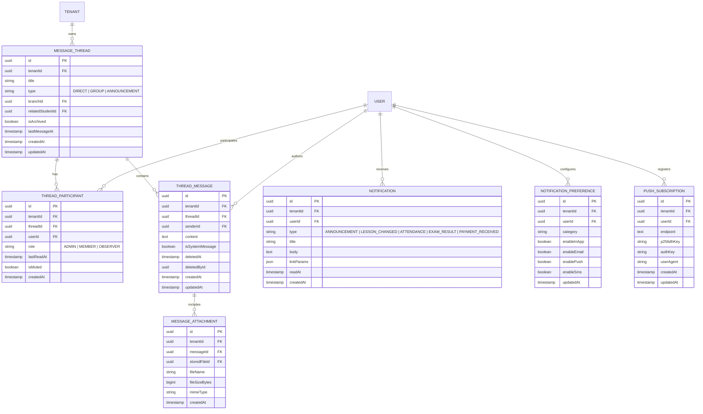
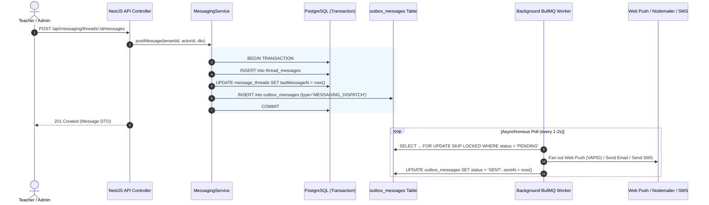

# MusicOS — Internal Messaging & Multi-Channel Notification Architecture

## 1. Executive Summary & Domain Mission

In a modern music conservatory, communication latency causes operational friction: uncommunicated lesson cancellations strand teachers, missed practice feedback discourages students, and payment reminder delays impair cash flow.

**MusicOS Messaging & Notification Engine** provides a unified, auditable, multi-channel communication infrastructure that connects:
- **Administration / Secretariat** ↔ Teachers, Students, and Guardians (Broadcast announcements, emergency closures, tuition invoices).
- **Teachers** ↔ Guardians and Students (Session notes, rehearsal call times, recital preparations, practice feedback).
- **System Events** ↔ Users (Automated timetable shift alerts, exam schedules, protocol document issuances).

All communications comply strictly with **GDPR regulations regarding minors** and Greek statutory educational directives.

---

## 2. Multi-Channel Communication Matrix

MusicOS implements a four-tier dispatch pipeline:

| Channel | Delivery Latency | Primary Use Cases | Technology & Transport |
|---|---|---|---|
| **In-App Realtime** | Immediate (< 100ms) | Active session notifications, unread count badge, toast alerts | Cls context, PostgreSQL notification queries, SSE / WebSocket |
| **Web Push (PWA)** | < 3 seconds | Mobile lockscreen alerts for schedule cancellations, emergency announcements | Web Push API, VAPID keys, Service Worker `PushManager` |
| **Email (Transactional)** | < 15 seconds | Payment receipts, formal document issuance, exam notices, password resets | PostgreSQL Outbox Pattern (`OutboxMessage`), Nodemailer, HTML templates |
| **SMS / Viber OTP & Urgency** | < 10 seconds | Same-day sudden teacher absence, last-minute room rescheduling, MFA OTP | Greek SMS Gateway adapters (Modulus, AlphaSMS) + Twilio fallback |

---

## 3. Child Safety & Minor Protection Governance

Under Greek Law (GDPR 4624/2019 and Regulation (EU) 2016/679):
1. **No Unsupervised 1-to-1 Minor Messaging:**
   - Any conversation between a Teacher and a Student under the statutory age of consent (15 in Greece) **must automatically include the registered Guardian as a mandatory participant**.
   - Guardians possess real-time visibility into all thread messages and attachments.
2. **Guardian Portal Centralization:**
   - Guardians with multiple enrolled children can filter communication threads per child or view a consolidated family inbox.
3. **Audit Trail & Non-Repudiation:**
   - Neither teachers nor guardians can permanently delete messages from the database. Deleted messages are soft-hidden with `deletedAt`, retaining an immutable audit record for legal and institutional compliance.

---

## 4. Entity-Relationship Model (Mermaid ERD)

---

## 5. Architectural Flow: Outbox Pattern & Background Workers

To ensure zero dropped notifications without locking synchronous HTTP requests:

---

## 6. Granular RBAC Permissions

| Key | Code | Allowed Roles | Description |
|---|---|---|---|
| **Thread Create** | `messaging.create` | DIRECTOR, ADMINISTRATOR, TEACHER, GUARDIAN | Start a new message thread within authorized scope |
| **Thread Reply** | `messaging.reply` | ALL ROLES (Thread Participant) | Post a reply to an existing active thread |
| **Broadcast Post** | `announcements.write` | DIRECTOR, ADMINISTRATOR, authorized TEACHER | Post announcements to entire institution or departments |
| **Moderate Messages**| `messaging.moderate` | DIRECTOR, ADMINISTRATOR | View, flag, or soft-delete inappropriate messages |

---

## 7. Rate Limiting & Abuse Prevention

1. **Volume Throttling:**
   - Maximum 30 messages per 10-minute window per student/guardian to prevent spamming teachers.
   - Maximum 5 new thread creations per hour per non-staff user.
2. **File Upload Restrictions:**
   - Supported file extensions: `.pdf`, `.mp3`, `.wav`, `.m4a`, `.png`, `.jpg`.
   - Executable extensions (`.exe`, `.sh`, `.bat`, `.js`) are strictly forbidden and rejected at the gateway.
   - Maximum attachment size: 10 MiB per file; maximum 3 files per message.
3. **Working Hours / Quiet Hours:**
   - Conservatories can configure institutional quiet hours (e.g. 21:30 – 08:00).
   - Non-emergency notifications delivered during quiet hours are buffered and dispatched at 08:00 the following morning.
